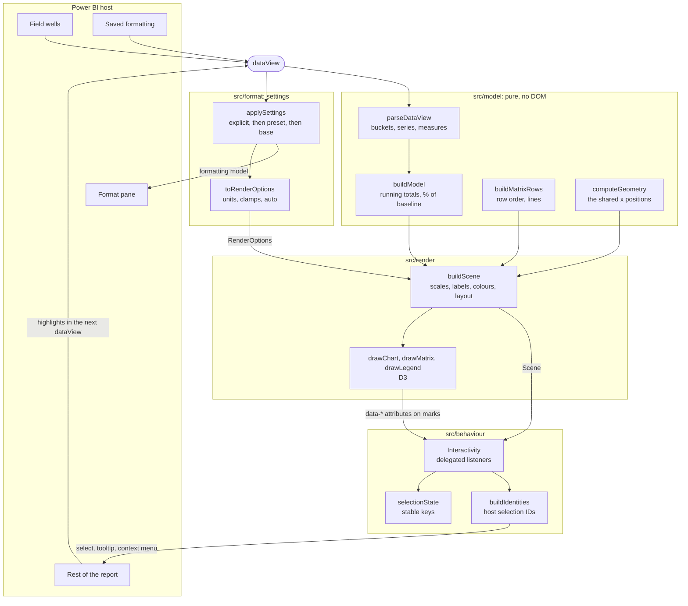

# Architecture

How a field well becomes a pixel, and how a click gets back to Power BI. [SPEC.md](SPEC.md) says *what* the visual does; this says *how* it's built.

## The flow



`src/visual.ts` is the thin glue. Each `update()` builds the settings, renders, then hands the resulting scene to `Interactivity`:

```ts
const applied = applySettings(dataView, { palette, strings, ...readInstances(dataView, seriesSelector, blankLabel) });
const scene = renderer.render(dataView, viewport, toRenderOptions(applied));
interactivity.update(scene, dataView);
```

`Renderer.render` returns `null` when it shows an empty state or a message instead of a chart, and `Interactivity` then has nothing to attach to.

## The layers, and the rule between them

| Folder | Job | Rule |
|---|---|---|
| `src/model/` | Turns the dataView into typed numbers and positions | Pure functions: no DOM, no host. This is where most of the unit tests are. |
| `src/format/` | Resolves what the author saved | The only code that reads saved formatting. `toRenderOptions` is the one boundary to the renderer. |
| `src/render/` | Draws | Reads `Scene` and draws. It computes no x positions of its own. |
| `src/behaviour/` | Selection, tooltips, keyboard | Reads marks from `data-*` attributes, so drawing and interaction stay decoupled. |
| `src/settings.ts`, `capabilities.json` | The contract | Everything an author can bind or set. Stored in reports, so names never change. |

## Key types

| Type | File | What it is |
|---|---|---|
| `ParsedDataView` | `model/types.ts` | The dataView made safe: `buckets`, `series`, `measures`, and `values[measureKey][seriesIndex][bucketIndex]`. |
| `SCurveModel` | `model/types.ts` | Adds the plotted `lines`, `lineDetails`, the effective `displayAs` and `warnings`. |
| `MeasureInfo` | `model/types.ts` | One entry per role and measure, with the key `${role}:${queryName}`, so a measure in two wells is two entries. |
| `XGeometry` | `model/geometry.ts` | `plotLeft`, `plotWidth`, `contentWidth` and each bucket's `x0`, `x1` and `center`. |
| `MatrixRow` | `model/matrix.ts` | One matrix row: its values, total, label, level and `lineBelow`. |
| `RenderOptions` | `render/options.ts` | Settings in renderer units, with `null` where a colour should come from the theme. |
| `Scene` | `render/scene.ts` | Everything the drawers need for one update. |
| `Selector` | `behaviour/selectionState.ts` | What's selected: `{ bucket, series, measure }` as stable keys, where `null` matches anything. |
| `Identities` | `model/identity.ts` | Host selection IDs for buckets, series, marks and measures. |

## Where the shared geometry lives

Keeping the chart and matrix aligned is the point of the visual, so there's exactly one place that computes x positions: `computeGeometry` in `src/model/geometry.ts`.

1. `buildScene` measures the axes and the matrix's text, and passes the widths to `computeLayout` (`src/render/layout.ts`).
2. `computeLayout` takes the wider of the left axis and the row headers as the left gutter, and the wider of the right axis and the totals column as the right gutter, and then calls `computeGeometry`. The chart and the matrix get the same gutters, so the plot range is the same pixels in both.
3. `computeGeometry` returns one `BucketGeometry` per bucket. Bars, line points, axis labels and matrix cells all read from it.
4. Matrix cells are absolutely positioned SVG, never a table layout, which would size columns on its own.

When the minimum bucket width makes the content wider than the plot, one scroll offset is applied as the same `translate` to the chart's and the matrix's scrolled layers. Axes, row headers and totals stay pinned. The matrix's vertical scrollbar is reserved in the right gutter, so it can't shift the columns.

The harness checks this contract in the real DOM: at the first, middle and last bucket, the bar, line point, axis label and cell centres must agree within 0.5 px, including while scrolled.

## How selection IDs flow

Selections are held as stable keys rather than indices, so a filter change or an inserted empty week can't move a selection onto a different week.

**Click to host:**

1. One delegated listener on the root receives the click. Listeners are attached once; each update only swaps the scene they read, so they can't accumulate.
2. `readMark` reads what was hit from its `data-role`, `data-bucket`, `data-series`, `data-measure` or `data-row`.
3. `selectorFor` turns the mark into a `Selector` of stable keys, and `nextSelection` applies the click rules: a plain click selects, or clears the only selected mark, and Ctrl or Cmd toggles.
4. `identitiesFor` turns each selector into host IDs through `buildIdentities`. A week holds one ID per source row, because daily data has several rows per week. A mark combines category, series and measure.
5. `selectionManager.select(ids)` filters the rest of the report. Power BI doesn't call `update()` after a visual's own select, so emphasis is reapplied in the handler.

**Measure-only selections** (a measure's row header or legend entry) have no bucket or series, so `isLocalOnly` keeps them inside the visual: they emphasise the measure and filter nothing.

**Host to visual:**

- **Highlights** from another visual arrive in the next dataView, and `parseDataView` keeps them next to the values: bars draw the full value faded with the highlighted part solid, and lines draw both.
- **Restored selections** from bookmarks arrive through `registerOnSelectCallback`. `restore` looks each one up in an index of every ID the visual can send, built on the first restore after an update, and maps the matches back to selectors. A measure in both wells is one host column, so its bar and line point share an ID and a restored point can't tell them apart.
- After each update, `pruneSelection` drops selectors whose week, series or measure no longer exists.

## Settings

The resolution rule (`src/format/resolve.ts`) is `explicit ?? preset ?? base`. *Explicit* means present in the saved formatting, so a saved `false`, `0` or `""` beats a preset.

- `applySettings` builds a fresh formatting model on every update, showing effective values in the pane. Per-measure and per-series slices are created there, so they can't pile up between updates.
- A measure's settings are saved on its column with the selector `{ metadata: queryName }`. Since a measure in two wells is one column, settings that differ by row kind need separate properties, such as `columnRowPosition` and `lineRowPosition`.
- Colours reach the renderer only when the author set them, so a theme switch still applies everywhere else.
- `LIMITS` in `src/settings.ts` feeds both the pane's validators and the clamp on saved values.

## Localization

All strings live in `defaultStrings` (`src/render/strings.ts`) and in `stringResources/<locale>/resources.resjson`, with the key `Visual_<key>`; unit tests keep them identical. The formatting library translates display names only, so `settings.ts` holds string keys in dropdown items and placeholders until `applySettings` translates them.

Number and date formats go through Power BI's value formatter in the host locale. The packager keeps formats only for locales with a `stringResources` folder, which is why 20 folders hold an empty `{}`: they exist to ship their locale's formats.

## How it's tested

See [TESTING.md](TESTING.md). In short, the model has unit tests because it's pure. The harness loads the JavaScript and CSS from the packaged visual into headless Chrome with a mock host, and clicks with `document.elementFromPoint`, so a mark covered by a label fails just as it would for a real pointer.
