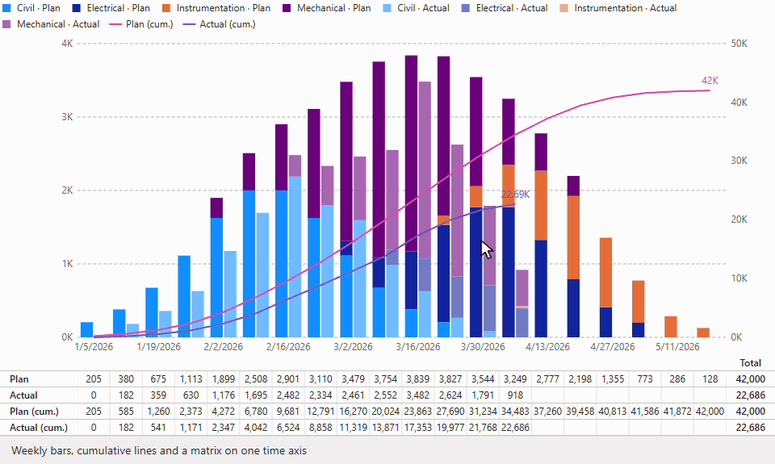

# Physical Progress S-Curve

[](https://github.com/igorpeixoto/powerbi-s-curve-visual/actions/workflows/ci.yml)

Planned vs. actual physical progress S-curve for project controls: weekly bars, cumulative lines and a summary matrix, all aligned on one time axis.



*Recorded in headless Chrome with the sample data and the test harness's mock host, so Power BI's own tooltips and Format pane aren't shown.*

## Why

Project planners track physical progress with an S-curve: for each week, the planned and actual quantities of work, plus their running totals. In Brazil it's the *curva de avanço físico*. It usually lives in Excel, as a chart with a table pasted under it, and the two never quite line up.

This visual rebuilds it natively for Power BI. Bars, lines and matrix cells are all positioned from one shared calculation, so every matrix column sits exactly under its week, at any width and while scrolling.

## Features

- **Columns** for per-week values on the left axis, stacked or clustered by series.
- **Cumulative lines** on the right axis. The visual computes the running totals itself, so the same measure can go in both *Column values* and *Line values*. Lines can also show a percentage of a baseline measure.
- **Aligned matrix** under the chart, with a totals column, optional series rows, a custom row order and a separate width for each row's line, so rows can be grouped and told apart.
- **Weekly bucketing** from any date field, with a Monday or Sunday week start, and labels as dates, ISO weeks or project weeks, on one line or two. A text field works too, for any other grain.
- **Report behaviour**: cross-filtering, highlights from other visuals, tooltips including report-page tooltips, context menu, keyboard navigation and high-contrast support.
- **Theme-aware**: every default colour comes from the report's theme.
- **Text**: font, size, bold, italic, underline and colour for axis labels, axis titles, data labels, the legend and the matrix, and a background with colour and opacity for data labels.
- **Languages**: English and Brazilian Portuguese, with number and date formats for 22 locales.

### Presets

| Preset | What it looks like |
|---|---|
| **Classic S-curve** (default) | Columns, cumulative lines with end labels, and the matrix |
| **Weekly progress** | Tighter, labelled columns with thin, lighter lines, and no matrix |
| **Minimal** | Lines only, with solid light gridlines and the legend at the bottom |

Anything you set by hand in the Format pane beats the preset, and survives switching presets.

### Field wells

| Well | Takes | Use |
|---|---|---|
| Date *or* Category | One date or text field | The time axis. Dates are grouped into weeks. |
| Series | One field (optional) | Splits measures, for example by discipline. |
| Column values | Up to 6 measures | Per-week bars. |
| Line values | Up to 6 measures | Lines, accumulated by default. |
| Table-only values | Up to 10 measures | Rows shown only in the matrix. |
| Tooltips | Fields | Extra tooltip content. |

The full contract, including non-goals such as drill-down, monthly bucketing and earned-value metrics, is in [SPEC.md](SPEC.md).

## Quick start

1. Download the `.pbiviz` from [Releases](https://github.com/igorpeixoto/powerbi-s-curve-visual/releases).
2. In Power BI Desktop, open **…** (Get more visuals) in the Visualizations pane, then **Import a visual from a file**, and choose the file.
3. Add a date field to **Date**, and your planned and actual measures to both **Column values** and **Line values**.

In the Date well, use the date field itself rather than its Date Hierarchy, and put one field in the Category well, not a hierarchy. The visual tells you if you forget.

### Open the sample

[`samples/report`](samples/report) is a small report on a fictional EPC project, with the visual already inside it:

1. Open `samples/report/s-curve-sample.pbip` in Power BI Desktop.
2. Go to **Home ▸ Transform data ▸ Edit parameters** and set `SampleDataFile` to the full path of `samples/data/epc_progress.csv` on your machine.
3. Click **Refresh**. The report stays empty until you do, because the data cache isn't in git.

All the data is made up by [`tools/generate_sample_data.py`](tools/generate_sample_data.py).

On Windows, clone into a short folder such as `C:\src`. The longest file path in the sample report is 182 characters, so with Windows' default limit of 260, a checkout fails when the path to the clone is longer than about 78 characters. `git clone -c core.longpaths=true` gets past the checkout, but opening the report from a path that long in Desktop hasn't been tested, so a short folder is the safer choice.

## How it was built

This visual is also an experiment: how much of a real, tested Power BI visual can an AI build? I wrote the plan and made the decisions; [Claude Code](https://claude.com/claude-code) wrote the code, tests and docs. Every session is logged in [docs/BUILD_LOG.md](docs/BUILD_LOG.md).

- **What I did:** defined the product and the phases, settled the open questions in the spec, reviewed each phase, tested in Power BI Desktop, asked for features clients ask for, and reviewed the Portuguese.
- **What the AI did:** wrote the spec draft, the TypeScript, the tests, the CI, the sample and these docs, and reported back at the end of each phase.
- **How it worked:** spec first, then pure logic with tests, then rendering, interaction and the Format pane. The test suite runs the packaged visual in headless Chrome against a mock host. New tests were checked by breaking the code on purpose and confirming that they failed.
- **What only the real Power BI could show:** a measure in two wells arrives as one column with its well order lost; the Date well can send a date hierarchy instead of dates; group names that are unique per card still collided in the Format pane; a default line width of 0.5 couldn't be reached with the pane's arrows. Each one came from a Desktop session, not from a passing test.

## Architecture

See [ARCHITECTURE.md](ARCHITECTURE.md) for how a field well becomes a pixel, where the shared geometry lives and how selections flow. [TESTING.md](TESTING.md) lists what's automated and what's still a manual check.

## Development

Requires Node 24 and, for the sample data tests, Python 3.

```bash
npm ci
npm test              # lint, type check, contract and sample checks, unit tests, headless harness
npm run package       # writes the .pbiviz to dist/
npm start             # dev server for the Developer Visual
```

A release is a tag: pushing `vX.Y.Z` runs the tests, packages the visual and creates a GitHub Release. See [RELEASING.md](RELEASING.md), and [CONTRIBUTING.md](CONTRIBUTING.md) if you'd like to help.

## Contact

Bugs and feature requests: [GitHub Issues](https://github.com/igorpeixoto/powerbi-s-curve-visual/issues). Anything else: visuals@igorpp.dev.

## License

[MIT](LICENSE)
